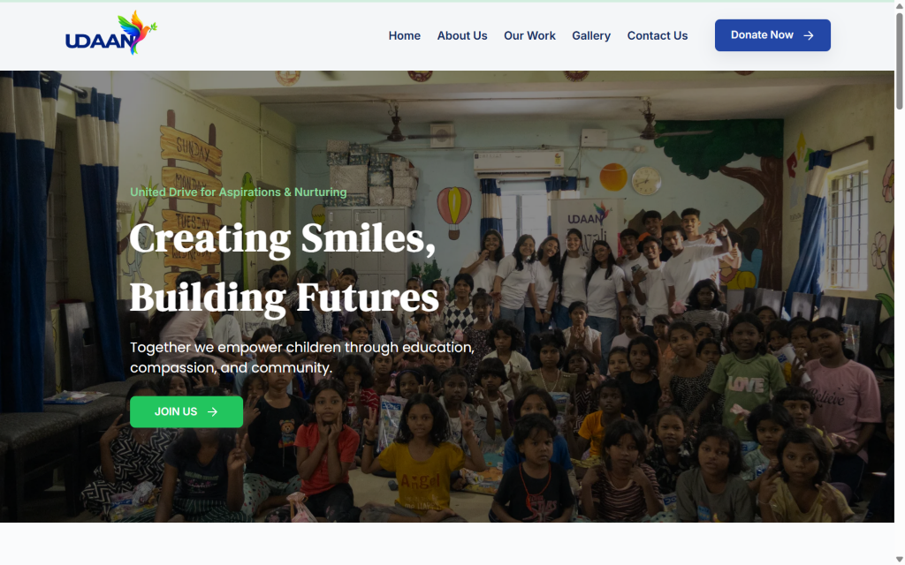
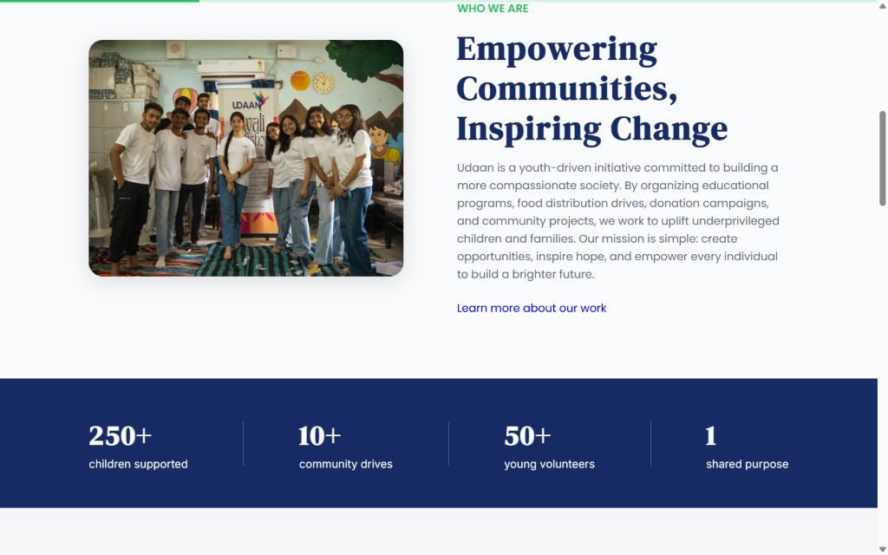
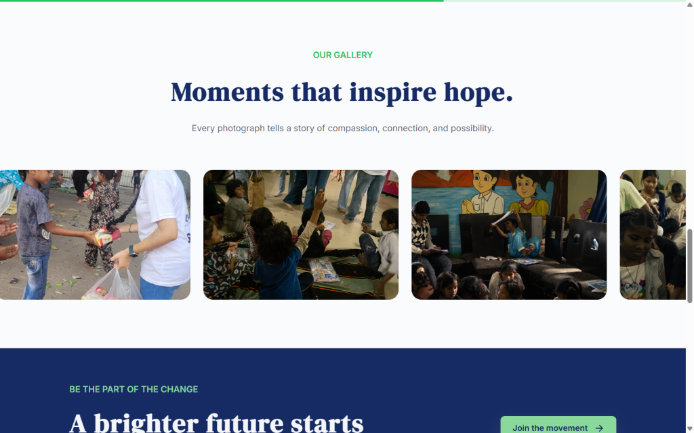
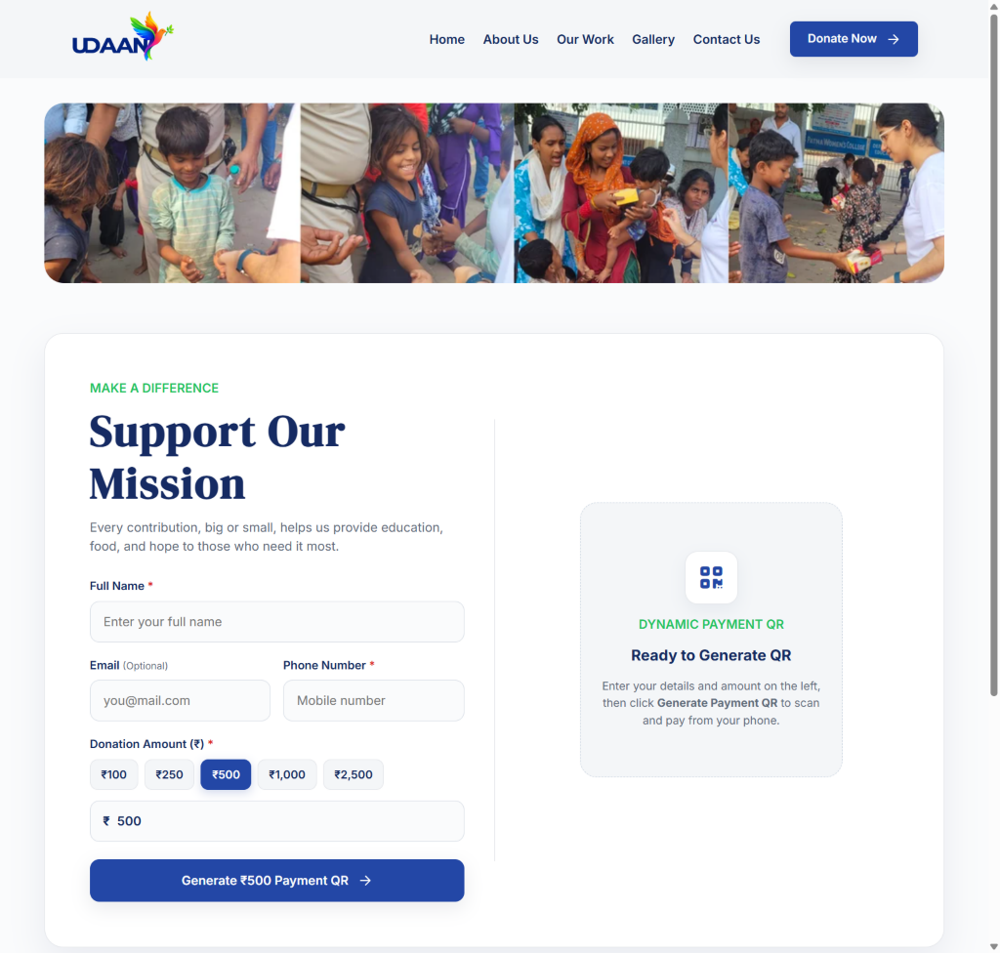

# Udaan — Official NGO Website

**Udaan** (*United Drive for Aspirations and Nurturing*) is a youth-led nonprofit organization committed to empowering underprivileged children and communities through education, food distribution drives, donation campaigns, and grassroots social initiatives.

🌐 **Live Website:** [https://teamudaan.org](https://teamudaan.org/)

---

## ✨ Key Features

- **Fast, Lightweight Performance**
  - WebP/AVIF optimized photography and icons with native lazy-loading below the fold.
  - Brand-matched page preloader for smooth initial presentation.
- **Responsive Across All Devices**
  - Tailored layouts for desktops, tablets, and compact phones (down to `320px` width) with mobile drawer navigation and scroll progress indicator.
- **Smart Device-Aware UPI Donation Flow (`donation.html`)**
  - Collects donor name, phone number, optional email, and preset or custom donation amounts (`₹100`, `₹250`, `₹500`, `₹1,000`, `₹2,500`, or custom).
  - **Mobile Phones:** Launches the installed UPI app directly (`upi://pay`) with the chosen amount and reference note pre-filled.
  - **Desktops & Tablets:** Generates a live, dynamic SVG UPI QR code on submission for quick scanning from any phone.
  - **Dedicated NGO Email Alerts:** Sends donation records to a separate Web3Forms inbox independently from general enquiries.
- **Inline Enquiries & Contact Form (`index.html`)**
  - Asynchronous Web3Forms submission with topic selection, inline validation, and confirmation feedback without leaving the page.
- **Search & Social Optimization (SEO)**
  - Semantic HTML5, Schema.org JSON-LD (`NGO`, `Organization`, `WebPage`, `BreadcrumbList`), Geo metadata, `robots.txt`, `sitemap.xml`, and dedicated Open Graph / Twitter Card previews.

---

## 🛠️ Tech Stack

| Layer | Technology |
| :--- | :--- |
| **Structure** | Semantic HTML5 |
| **Styling** | CSS3 (Custom Properties, Flexbox, Grid, Responsive Media Queries) |
| **Interactivity** | Vanilla JavaScript (ES6+) |
| **Dynamic QR** | [qrcode-generator](https://cdnjs.cloudflare.com/ajax/libs/qrcode-generator/1.4.4/qrcode.min.js) + NPCI UPI Deep Links |
| **Form Handling** | [Web3Forms](https://web3forms.com/) (separate keys for Enquiries & Donations) |
| **Icons & Fonts** | Font Awesome 6, Google Fonts (`DM Serif Display`, `Inter`, `Poppins`) |
| **Hosting** | Cloudflare Pages |

---

## 📁 Project Structure

```text
udaan-website/
├── assets/
│   ├── gallery/          # Optimized WebP & JPEG community drive photos
│   ├── icons/            # Feature card icons and favicon
│   ├── img/              # Hero, About, Donation banner, and Open Graph images
│   ├── logo/             # Udaan brand logo assets
│   └── qrcode/           # Static fallback UPI QR code
├── css/
│   └── main.css          # Global styles, theme variables, responsive breakpoints & preloader
├── js/
│   └── script.js         # Navigation, scroll progress, preloader, enquiries & dynamic UPI QR logic
├── screenshots/          # Website previews for documentation
│   ├── home.png
│   ├── about.png
│   ├── gallery.png
│   ├── contact.png
│   └── donation.png
├── donation.html         # Device-aware UPI & dynamic QR donation page
├── index.html            # Main landing page
├── robots.txt            # Search engine crawler directives
├── sitemap.xml           # XML sitemap for indexing
└── README.md
```

---

## 📷 Preview

### Home & Hero


### About & Impact Stats


### Community Gallery


### Get Involved & Enquiries


### Donation Page (Dynamic QR & UPI Flow)


---

## 💡 Purpose

This digital platform enables Udaan to:

- Share its mission, community initiatives, and measurable impact transparently.
- Connect prospective volunteers, collaborators, and sponsors directly with the team.
- Provide a fast, accessible, and frictionless donation experience on both mobile and desktop.

---

## 👨‍💻 Developer

**Vaibhav**  
Designed and developed as part of a web development journey while contributing to a meaningful social cause.

- GitHub: [@vaibhavvraj](https://github.com/vaibhavvraj)

---

## 📄 License

This project is intended for the official use of **Udaan**.  
All rights reserved unless otherwise specified.
