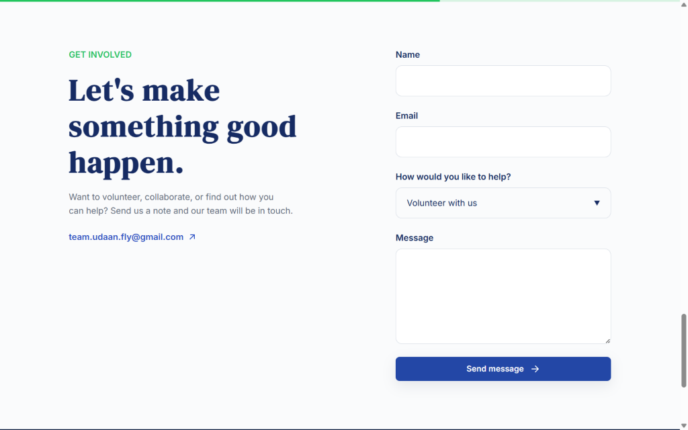

# Udaan - Official Website

Website for **Udaan** (*United Drive for Aspirations and Nurturing*), a youth-led community initiative working to support underprivileged children and families through education, food drives, and community outreach.

**Live Site:** [teamudaan.org](https://teamudaan.org/)

---

## Features

- **Responsive Layout:** Works cleanly across desktops, tablets, and mobile screens with a mobile nav menu and scroll progress bar.
- **Fast Loading:** Compressed WebP images, lazy loading for lower sections, and a simple loading screen on initial visit.
- **Donation Page (`donation.html`):**
  - Preset amount buttons (`₹100` to `₹2,500`) plus a custom amount field.
  - Opens the installed UPI app directly on mobile phones, and generates a scannable payment QR code on desktops and tablets.
  - Sends contribution details straight to Udaan's official email via Web3Forms.
- **Contact & Enquiries Form:** Lets volunteers, partners, and supporters reach out directly from the home page without leaving the site.
- **SEO & Analytics:** Configured with Open Graph / Twitter previews, sitemap, `robots.txt`, and Google Analytics.

---

## Built With

- **HTML, CSS & JavaScript**
- **Web3Forms** (separate forms for enquiries and donations)
- **qrcode-generator** (dynamic UPI QR codes)
- **Cloudflare Pages** (hosting & deployment)
- **Codex & Antigravity** (AI coding assistants used during development, optimization, and responsive polish)

---

## Project Structure

```text
udaan-website/
├── assets/
│   ├── gallery/          # Gallery photos
│   ├── icons/            # Card icons and favicon
│   ├── img/              # Hero, About, Donation banner & OG images
│   ├── logo/             # Udaan logo
│   └── qrcode/           # Fallback UPI QR image
├── css/
│   └── main.css          # Stylesheet and responsive rules
├── js/
│   └── script.js         # Navigation, preloader, forms & UPI QR logic
├── screenshots/          # Site previews
│   ├── home.png
│   ├── about.png
│   ├── gallery.png
│   ├── contact.png
│   └── donation.png
├── donation.html         # Donation page
├── index.html            # Home page
├── robots.txt
├── sitemap.xml
└── README.md
```

---

## Screenshots

### Home


### About & Impact


### Gallery


### Contact


### Donation Page


---

## Developer

**Vaibhav**  
Built as a personal web development project to give Udaan a clean online presence - designed and coded hands-on with help from AI agents (**Codex** and **Antigravity**) for optimization, layout fixes, and refinements.

- GitHub: [@vaibhavvraj](https://github.com/vaibhavvraj)

---

## License

Intended for the official use of **Udaan**. All rights reserved unless otherwise specified.
